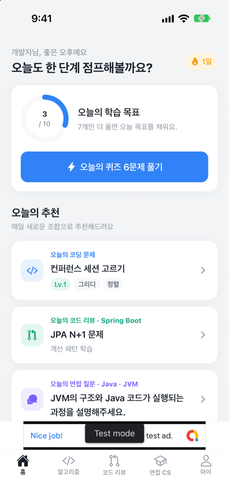
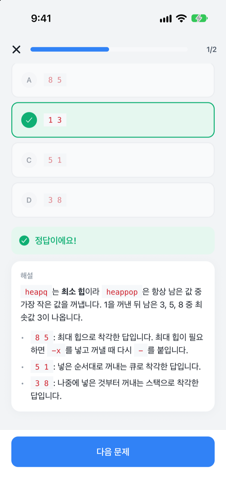
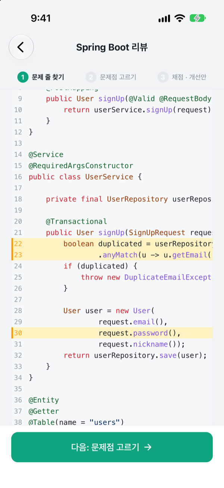
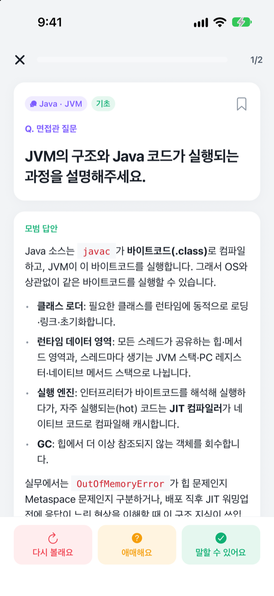
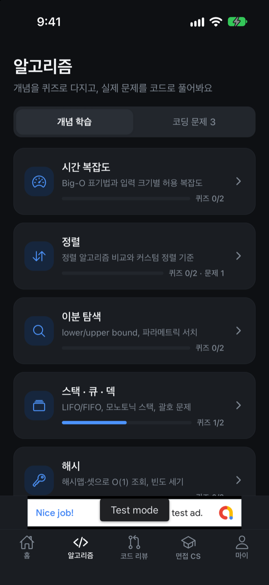

# To Jump Programmer — 개발자 취업·이직 준비 앱

코딩 테스트, 코드 리뷰 테스트, 기술 면접을 **한 앱에서** 준비하는 모바일 학습 앱입니다.
**백엔드 · 프론트엔드 · 풀스택** 코스 중에서 고르면 코스에 맞는 면접 질문과 코드 리뷰가 나오고, 하루 10분씩 CS 이론·퀴즈·알고리즘 유형·면접 카드로 꾸준히 학습하도록 설계했습니다.

**[웹에서 바로 사용하기 → jumpprogrammer.app](https://jumpprogrammer.app)** 설치 · 로그인 없이 브라우저에서 바로 쓰고, 휴대폰에서는 홈 화면에 앱처럼 설치할 수 있습니다 (PWA).

| 기기 | 설치 방법 |
| --- | --- |
| Android | Chrome 에서 열고 홈 화면의 [앱 설치] 버튼, 또는 메뉴 › 앱 설치 |
| iPhone · iPad | Safari 에서 열고 공유 버튼 › 홈 화면에 추가 |
| PC | Chrome · Edge 주소창의 설치 아이콘 |

| 트랙 | 기능 |
| --- | --- |
| **알고리즘 · 코딩 테스트** | 15개 토픽 개념 정리 + 개념 퀴즈 122문항 · 자주 출제되는 **문제 유형 44개**를 Python · Java · Kotlin · C++ · JavaScript **구현 예제 80개**로 비교 학습 (유형마다 접근 방식이 다른 구현 1~3가지 · 코드 줄에 연결된 핵심 해설) |
| **코드 리뷰 테스트** | 백엔드 Spring Boot(Java · Kotlin 전환) / Node.js·NestJS / Django·Flask, 프론트엔드 React / Vue 별 **개선 패턴 학습** 10개(개선 전·후 코드, 변경점 diff, 리뷰 체크리스트)와 **리뷰 실전 퀴즈** 6개(문제 줄 찾기 → 문제점 고르기 → 채점 · 모범 리뷰 · 베스트 개선안) — 총 80개 |
| **기술 면접 CS** | 35개 카테고리 — 공통(OS · 네트워크 · 자료구조 · 보안 · JS/TS · OOP · 실무 · AI Agent 활용), 백엔드(DB · Java · Kotlin · Python · Spring · NestJS · Django · 아키텍처 · 인프라), 프론트엔드(브라우저 · HTML/CSS · 웹 성능 · 프론트엔드 보안 · 상태 관리·테스트 · React · Vue), **실전 사례 · 문제 해결** 11개(대규모 트래픽 · 데이터 마이그레이션 · 외부 연동 · 동시성 · 성능 병목 · 장애 대응 · 레거시 개편 · 프론트엔드 성능 · 개편 · 웹뷰/SSR · 의사결정 · 협업) — **이론 레슨 163개**(읽기 → 확인 퀴즈 3문제 → 틀리면 이론 복귀) + 퀴즈 593문항 + 면접 질문 카드 261장(모범 답안 · 핵심 키워드 자가 체크 · 꼬리 질문) |
| **개발자 코스** | 백엔드 · 프론트엔드 · 풀스택 중 선택. 면접 CS · 코드 리뷰 · 오늘의 추천이 코스와 고른 프레임워크에 맞춰 나오고, 풀스택은 두 쪽을 번갈아 균형 있게 추천 |
| **학습 관리** | 오늘의 추천 · 하루 목표 · 연속 학습일 · 학습 잔디 · 오답노트 · 북마크 · 다시 볼 카드 · 다크 모드 · 학습 기록 백업/복원(웹) |

> 알고리즘 구현 예제는 모두 5개 언어로 실제 실행해 검증합니다 (`npm run validate`).
>
> **이 공개 저장소에는 샘플 콘텐츠만 들어 있습니다.** 전체 학습 콘텐츠는 비공개 저장소로 관리하며, 샘플만으로도 앱의 모든 기능을 실행해 볼 수 있습니다. ([콘텐츠 구성](#콘텐츠-구성))

## 스크린샷

| 홈 · 오늘의 추천 | 개념 퀴즈 · 해설 |
| :---: | :---: |
|  |  |

| 코드 리뷰 퀴즈 | 면접 질문 카드 | 다크 모드 |
| :---: | :---: | :---: |
|  |  |  |

<sub>iPhone 17 시뮬레이터(iOS 27)에서 이 저장소의 샘플 콘텐츠로 촬영했습니다. 하단 배너는 개발 빌드에 나오는 Google 테스트 광고입니다.</sub>

---

## 기술 스택

서버 운영 비용 없이 앱 스토어에 출시할 수 있는 구성을 목표로 했습니다.

| 영역 | 선택 | 이유 |
| --- | --- | --- |
| 앱 | **Expo SDK 57 (React Native 0.86) + TypeScript** | iOS · Android · 웹을 하나의 코드로. EAS 클라우드 빌드로 스토어 출시 |
| 웹 (PWA) | Expo 웹 내보내기 + Workbox 서비스 워커 + **Cloudflare Workers**(정적 자산) | 브라우저 · 홈 화면 설치 · 오프라인 지원. `main` 에 푸시하면 GitHub Actions 가 배포 |
| 라우팅 | Expo Router (파일 기반) | 탭 + 스택 네비게이션, 딥링크 기본 지원 |
| 상태·저장 | Zustand + AsyncStorage | 학습 기록을 **기기에만 저장** → 서버·DB 없이 동작, 운영자가 수집하는 개인정보 없음 |
| 콘텐츠 | 앱 번들에 포함된 TypeScript 데이터 | CMS·API 서버 불필요. 콘텐츠 수정은 EAS Update(OTA)로 배포 |
| 코드 예제 | 읽기 전용 구문 강조(자체 하이라이터) + 핵심 해설 줄 강조 | 실행 서버 없이 5개 언어 예제를 오프라인으로 제공 |
| 콘텐츠 검증 | 로컬 컴파일러 · 인터프리터로 모든 구현 예제 실행 | 앱에서 실행하지 않는 대신, 콘텐츠를 쓸 때 정확성을 보장 |
| 수익화 | 앱: **Google AdMob** (`react-native-google-mobile-ads`) · 웹: **Google AdSense** | 무료 + 광고. 동의(UMP) · iOS 추적 허용(ATT) 처리 포함 |

---

## 주요 구현

### 알고리즘 유형 · 구현 예제

```text
[토픽] 개념 정리 ─▶ 유형 목록 ─▶ [유형] 이런 문제에서 써요 · 접근 방법 · 예제 문제
                                    └─ 구현 예제 1~3가지 (예: 재귀 vs 반복, 완전 탐색 vs 최적화) × 5개 언어
                                         └─ 핵심 해설 ↔ 코드 줄 강조 (같은 내용이 언어마다 다른 줄에 있어 줄 번호를 언어별로 지정)
```

- 코드는 앱에서 실행하지 않고 **읽으며 비교**합니다. 언어 칩으로 Python · Java · Kotlin · C++ · JavaScript 를 바꾸고, 해설 번호나 코드 줄을 누르면 해당 줄이 강조됩니다.
- 예제 코드의 정확성은 콘텐츠를 쓸 때 보장합니다. `npm run validate` 가 유형마다 예제 문제의 테스트를 모든 구현 · 모든 언어로 실행합니다. Java · Kotlin · C++ 는 테스트 입력을 리터럴로 넣은 하네스 코드를 만들어 컴파일하고, 표준 출력 마커로 결과를 비교합니다 (`scripts/lib/harness`).
- 이전 버전에는 직접 풀이 · 채점 기능(기기 내 Pyodide · Piston 실행 서버)이 있었지만, 실행 서버의 운영 비용 · 격리 보안 부담으로 제거했습니다. 기존 풀이 기록은 지우지 않고 보존합니다.

### CS 이론 학습 (이론 → 확인 퀴즈 → 이론 복귀)

- 카테고리마다 레슨 4~5개(읽기 3~7분: 왜 필요한가 → 핵심 개념 → 예시 → 면접 포인트 → 핵심 정리). 스크롤 진행률로 끝까지 읽었는지 기록하고, 안 읽음 · 읽는 중 · 완료 · 이해함 상태를 보여줍니다.
- 퀴즈 문항에 `lessonId` 를 달아 레슨과 연결합니다. 레슨을 읽은 뒤 연결된 문제 중 안 푼 문제를 먼저 3개 내고(제출하면 완료, 2/3 이상이면 이해함), 퀴즈 해설 · 결과 · 오답노트에서는 관련 레슨으로 이동합니다. 레슨을 스택에 쌓아 열기 때문에 돌아오면 풀던 퀴즈가 그대로 남아 있습니다.
- 검증 스크립트가 레슨마다 확인 퀴즈가 3개 이상인지, 퀴즈가 실제 레슨을 가리키는지, 연결되지 않은 퀴즈가 없는지 확인합니다.


### 실전 사례 · 문제 해결

- 면접 · 채용공고가 묻는 문제 해결 경험(대규모 트래픽 · 데이터 마이그레이션 · 외부 연동 · 장애 대응 …)을 사례 레슨 44개로 배웁니다. 레슨마다 **상황 → 원인 분석 → 선택지와 트레이드오프 → 적용한 해결 방안 → 결과와 검증 → 면접에서 말하는 법(STAR)** 순서로 쓰고, 판단형 퀴즈로 확인하고, 경험형 질문 카드(경험이 없을 때 답하는 법 포함)로 말하기 연습을 합니다.
- 주제는 채용공고 약 90건에서 자주 요구하는 문제 해결 경험을 분류해 정했습니다. 사례의 수치는 모두 예시이고, 특정 회사의 실제 장애 · 내부 사례는 쓰지 않습니다. 작성 규칙은 `docs/CONTENT_GUIDE.md` 3-2장.

### 객관식 보기 섞기 · 오답 풀

- 객관식은 볼 때마다 보기 순서를 섞어 정답 위치를 외워 맞힐 수 없게 합니다. 보기 구성은 (문제 id, 지금까지 푼 횟수)로 정해지는 결정적 무작위라 한 문제를 보는 동안에는 그대로이고, 다시 풀면 직전과 다른 정답 위치로 바뀝니다. 오늘의 퀴즈 · 레슨 확인 · 오답노트 · 북마크 등 모든 퀴즈 진입 경로와 코드 리뷰 챌린지의 문제점 보기가 같은 순수 모듈(`src/features/progress/choices.ts`)을 씁니다.
- 오답 풀 형식(`correct` + `distractors`) 문제는 오답 5~7개 중 3개를 골라 보여주고(직전과 다른 조합), 해설 아래에 이번에 보인 오답이 틀린 이유만 보여줍니다. 알고리즘 · CS 객관식 410문항 모두 오답 풀 형식이며, 고정 보기(`choices` + `answer`) 형식도 하위 호환으로 남아 있어 순서만 섞입니다.

### 개발자 코스 (백엔드 · 프론트엔드 · 풀스택)

- 프로필의 코스(`track`)와 프레임워크(백엔드 `framework`, 프론트엔드 `frontendFramework`)로 콘텐츠 범위를 정합니다. 범위 계산은 화면과 분리된 순수 함수(`src/features/progress/course.ts`)라 단위 테스트로 검증합니다.
- 오늘의 퀴즈 · 면접 CS 탭 · 학습 진행 요약은 같은 범위를 씁니다: 코스의 공통 · 코스 쪽 카테고리 중 고른 프레임워크의 언어 · 프레임워크 카테고리만(Spring 은 Java · Kotlin, NestJS · React · Vue 는 JavaScript · TypeScript, Django 는 Python). 면접 CS 탭은 이 범위를 먼저 보여주고 나머지 카테고리는 아래에 접어 둡니다.
- 오늘의 퀴즈의 알고리즘 문제는 코드가 없거나 내 언어(코딩 테스트 언어 + 고른 프레임워크의 언어)로 쓴 문제만 냅니다. 다른 언어로 쓴 문제는 알고리즘 탭의 토픽 퀴즈에서 풀 수 있습니다.
- 풀스택은 오늘의 퀴즈 CS 문제를 백엔드 · 프론트엔드 · 공통 묶음에서 번갈아 고르고, 오늘의 코드 리뷰와 면접 질문은 날짜마다 두 쪽을 엇갈려 추천합니다. 코드 리뷰 탭에는 백엔드/프론트엔드 전환이 있습니다.
- 저장된 학습 기록은 버전을 두고(`progress/migrate.ts`) 옮깁니다. 코스 도입 전 사용자는 백엔드 코스로 이어집니다.

### 코드 리뷰 언어 전환 (Spring Boot: Java · Kotlin)

- 같은 개선 패턴 · 리뷰 퀴즈를 Java 와 Kotlin 코드로 모두 제공합니다. 처음에는 코딩 테스트 기본 언어를 따라가고, 화면의 칩으로 바꿀 수 있습니다.
- 언어 버전 콘텐츠는 코드와 채점 줄 번호만 새로 쓰고, 설명은 그 언어에서 달라지는 필드만 덮어씁니다. 검증 스크립트가 숨겨진 이슈 수 · 줄 번호 · 덮어쓰지 않은 Java 코드 예시를 검사합니다.

### 광고

| 위치 | 형식 | 규칙 |
| --- | --- | --- |
| 앱: 탭 화면 하단(탭 바 위) | 배너 (320×50) | 항상. 불러오지 못하면 자리를 차지하지 않음 |
| 앱: 퀴즈 · 면접 카드 · 코드 리뷰 퀴즈를 마치고 나갈 때 | 전면 광고 | 세션 2번 마칠 때마다 1번, 앱 실행 직후·직전 광고 후 3분간 노출 안 함 |
| 웹: 탭 화면 · 알고리즘 토픽 · 유형 · 개선 패턴 · 리뷰 퀴즈 · 면접 카테고리 · CS 레슨의 콘텐츠 사이 | AdSense 반응형 디스플레이 | 광고 자리가 있는 콘텐츠 화면에서만 AdSense 스크립트를 불러오고, 화면을 옮길 때만 요청. 채워지지 않으면 자리를 차지하지 않음 |

- 문제를 푸는 중(퀴즈 진행 · 카드 학습)에는 광고를 띄우지 않습니다.
- 웹은 메뉴 · 버튼 가까이에 광고를 두지 않도록(실수 클릭 방지 정책) 탭 바 위 고정 배너 대신 콘텐츠 사이에 둡니다.
- 광고 ID 는 저장소에 넣지 않고 빌드 환경 변수로 주입하며, 값이 없으면 앱은 Google 테스트 광고로, 웹은 광고 없이 동작합니다. 웹 배포 · AdSense 설정은 [`docs/WEB.md`](docs/WEB.md) 에 있습니다.

---

## 콘텐츠 구성

| 위치 | 내용 | 공개 여부 |
| --- | --- | --- |
| `src/content/types.ts` 와 토픽·카테고리 목록 | 콘텐츠 스키마 | 공개 |
| `src/content/sample/` | 토픽마다 일부만 담은 샘플 (알고리즘 유형은 이분 탐색 · DFS/BFS 토픽만, CS 이론은 운영체제 · React 만) | 공개 |
| 비공개 저장소 | 전체 학습 콘텐츠 (CS 이론 · 퀴즈 · 알고리즘 유형 · 코드 리뷰 · 면접 카드, 백엔드 · 프론트엔드) | 비공개 |
| `src/content/data/` | 앱이 실제로 읽는 콘텐츠. `npm run content:sync` 가 전체 콘텐츠(없으면 샘플)를 복사 | git 제외 |

스토어 출시용(`production`) 빌드는 `src/content/data` 가 전체 콘텐츠가 아니면 실패하도록 해, 샘플로 출시되는 것을 막습니다.
콘텐츠 형식과 작성 규칙은 [`docs/CONTENT_GUIDE.md`](docs/CONTENT_GUIDE.md) 에 있습니다.

---

## 실행하기

```bash
npm install        # 설치 후 학습 콘텐츠를 자동으로 준비 (전체 콘텐츠가 없으면 샘플)
npm start          # Expo 개발 서버 (QR 코드를 Expo Go 앱으로 스캔)
npm run web        # 브라우저에서 실행 (개발 서버)
```

광고까지 확인하려면 개발 빌드(`npx expo run:ios` / `npx expo run:android`)로 실행합니다.

| 명령 | 설명 |
| --- | --- |
| `npm run typecheck` | 앱 · 스크립트 타입 검사 |
| `npm run lint` | ESLint (React Compiler 규칙 포함) |
| `npm test` | 핵심 로직 테스트 (마크다운 파서 · diff · 검증 하네스 비교 · 출력 파서 · 오늘의 퀴즈 구성 · 연속 학습일 · 백업 파일) |
| `npm run build:web` | 웹(PWA) 빌드 — `dist/` (콘텐츠 페이지마다 제목 · 설명 · 본문 HTML, 서비스 워커 · manifest · sitemap · robots.txt · ads.txt 포함) |
| `npm run preview:web` | 웹 빌드를 로컬 정적 서버로 띄워 확인 |
| `npm run test:harness` | 콘텐츠 검증용 Java · Kotlin · C++ 하네스 테스트 (JDK, kotlinc, g++/clang++ 필요) |
| `npm run validate` | 콘텐츠 구조 검증 + 알고리즘 구현 예제 5개 언어 실행 검증 (python3, node, JDK 15+, kotlinc, g++/clang++ 필요) |

---

## 프로젝트 구조

```text
src/
  app/                      # 화면 (Expo Router)
    (tabs)/                 #   홈 · 알고리즘 · 코드 리뷰 · 면접 CS · 마이
    algorithm/              #   토픽(개념 정리 · 유형 목록) · 유형 상세(구현 예제 · 핵심 해설)
    review/                 #   개선 패턴 학습 · 리뷰 실전 퀴즈
    interview/[id].tsx      #   CS 카테고리 상세
    quiz.tsx · cards.tsx    #   퀴즈 세션 · 면접 카드 세션
    notes · bookmarks · settings · privacy · onboarding
  components/               # UI 컴포넌트 (코드 블록 · diff · 마크다운 렌더러 등)
  content/                  # 학습 콘텐츠 (스키마 · 토픽/카테고리 목록 · 진입점)
    sample/                 #   공개용 샘플 콘텐츠
    data/                   #   앱이 읽는 콘텐츠 (git 제외)
  features/
    progress/               # 학습 기록 저장소 · 통계 · 오늘의 추천 · 백업/복원
    ads/                    # 광고: AdMob(앱 · 하단 배너 · 전면 광고 · 동의/ATT), AdSense(웹)
    pwa/                    # 웹 앱 설치(홈 화면 추가) 상태
  lib/                      # markdown-lite 파서 · 구문 강조 · diff · 날짜 유틸
  theme/                    # 디자인 토큰 (라이트/다크)
scripts/                    # 콘텐츠 동기화 · 검증(lib/harness: 5개 언어 실행 하네스) · 아이콘 생성 · 웹(PWA) 빌드
public/icons/               # 웹 앱 설치 아이콘
.github/workflows/          # 웹 버전 Cloudflare 배포 (wrangler.jsonc)
plugins/                    # 로컬 Expo config plugin (iOS UIScene 생명주기)
docs/                       # 콘텐츠 작성 가이드 · 웹 배포 가이드 · 개인정보 처리방침 · 스크린샷
```

---

## 로드맵

- 프론트엔드 트랙 (React · Next.js 코드 리뷰, 브라우저/프론트 CS)
- 계정 · 기기 간 학습 기록 동기화
- 콘텐츠 원격 업데이트 (앱 업데이트 없이 문제 추가)
- 알고리즘 문제 유형 · 구현 예제 확대
- 직접 풀이 · 채점 (실행 서버를 무료 · 안전하게 운영할 방법이 생기면 재검토)
- 면접 답변 음성 녹음 · 셀프 피드백
- 광고 제거 인앱 결제

## 오픈소스

Expo · React Native 를 사용합니다. 각 프로젝트의 라이선스를 따릅니다.

## 라이선스

Copyright (c) 2026 lgm1007. All rights reserved.
포트폴리오·참고 목적으로 열람만 허용하며, 코드와 학습 콘텐츠의 사용·복제·배포는 허용하지 않습니다. 자세한 내용은 [`LICENSE`](LICENSE) 를 참고하세요.
